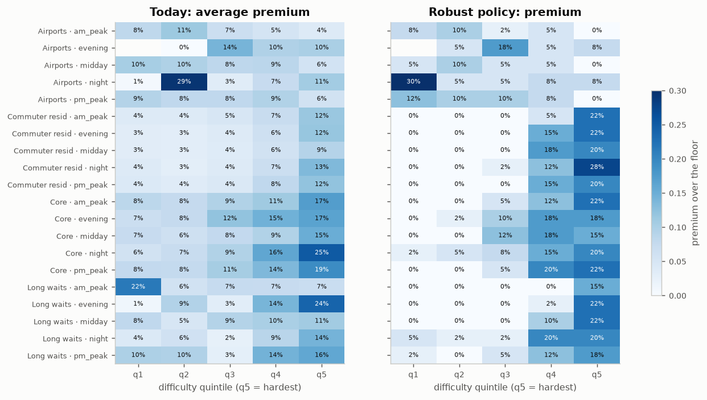

# Driver pay in a ride-hailing marketplace

[](https://janeruxi1-ridehail-driver-pay-optimization.streamlit.app/)
[](https://github.com/janeruxi1/ridehail-driver-pay-optimization/actions/workflows/ci.yml)

**What should a ride-hailing platform offer a driver for a trip?** Pay too little and riders wait,
cancel and drivers stop driving; pay too much and the margin disappears. This project answers that
end to end on **360 million real New York City trips** (January 2024 – June 2025):
a PySpark pipeline, marketplace-health analytics in SQL, a demand forecast, a classifier, a causal study
of a real policy change, a causal model of how drivers respond to pay, a constrained pay optimizer
tested in a dispatch simulation, a quote API in Docker with CI/CD, and a switchback test to roll it out.

> Scenario: the TLC records are treated as the history of one platform. Trips, pay, fares and waits are
> real; driver accept/decline decisions are simulated on top of them with a planted truth (the public
> data doesn't record them), which is what lets the causal methods be checked. Details below.

## Results

| Question | Answer | Notebook |
|---|---|---|
| How is pay set today? | The median trip is paid **1.003×** NYC's minimum pay for its miles and minutes; 53% of trips are paid within 1% of it. The **premium** above it (7.9% of all driver pay) is the lever. | [01](notebooks/01_marketplace_health.ipynb) |
| Where is the marketplace under strain? | Waits track the supply–demand *balance*, not demand: the longest are around 4am on Sundays (correlation with hourly trips -0.15). Zones fall into 3 stable clusters plus airports. | [01](notebooks/01_marketplace_health.ipynb) |
| How many trips next month, by zone and hour? | Weighted MAPE **12.7%** at zone × hour vs 13.4% (4-week mean) and 16.4% (seasonal naive); Poisson noise alone would give 6.8%. | [02](notebooks/02_demand_forecast.ipynb) |
| Will this request wait > 10 minutes? | LightGBM, ROC AUC **0.73**, calibrated; a cost-based threshold fixed in advance cuts expected cost 16%. | [03](notebooks/03_long_wait_classifier.ipynb) |
| What did the 2025 congestion fee do? | Traffic in the zone got **0.65 mph faster (4.6%)**, robust to placebo dates. Pickups fell, but by 9% or about 1% depending on the design. Effects on waits and driver pay are **not** distinguishable from placebo noise. | [04](notebooks/04_congestion_fee.ipynb) |
| How much does 10% more pay raise acceptance? | The history says +3.2 pp; the truth is +6.3 pp (premiums go to the trips drivers dislike). **Double ML** and the **randomized pay test** each recover their estimand; with a hidden confounder only the test does. | [05](notebooks/05_pay_to_accept.ipynb) |
| What should we pay? | A robust MILP policy: **+2.8% margin per request** on held-out months, scored against the truth, with rider wait, acceptance and driver earnings guardrails all met. Cutting to the floor would "earn" +27% and break all three. | [06](notebooks/06_pay_policy_simulation.ipynb) |
| Does it hold up with real requests and moving drivers? | In a dispatch simulation replaying the real Brooklyn requests of two days, the policy raises first-offer acceptance by 1.4 points and cuts the p90 wait by 0.36 min, at a cost of $0.11 of margin per request there (as the expected-value model predicts for Brooklyn). Batched matching cuts mean wait by 8.3 min vs greedy. | [06](notebooks/06_pay_policy_simulation.ipynb) |
| How do we roll it out? | Switchback test: region × 2-hour blocks, first hour washed out, randomization inference; sized on real data: **8 weeks** to detect the expected effect. | [07](notebooks/07_switchback_design.ipynb) |

🎮 **[Try the live demo](https://janeruxi1-ridehail-driver-pay-optimization.streamlit.app/)**: quote a trip, explore where the policy puts premiums, and size the rollout test.

Every number here is read from [`reports/metrics/`](reports/metrics), written by the notebooks when they
run on the real data. The decision write-up is in [`reports/decision_memo.md`](reports/decision_memo.md).



## The problem

A rider requests a trip; the platform offers it to a driver at an upfront pay; the driver accepts or
declines; a declined trip goes to the next driver. **The pay offered is the decision.**

- **Objective:** expected margin per request = P(trip completes) × (fare − pay) − P(rider gives up) × cost.
- **Constraints**, each owned by a different team:
  C1 pay between the regulatory floor and 1.3× it · C2 the same trip gets the same offer whoever receives it ·
  C3 rider wait per segment no worse than today · C4 first-offer acceptance no lower than today ·
  C5 driver earnings per hour per zone group at least 95% of today.
- **The trap:** operations add premiums to hard trips (short, late at night, into areas where drivers get
  stranded). Drivers decline those trips anyway, so in the history extra pay arrives with extra
  difficulty and pay looks far less effective than it is.

Full brief: [`reports/scenario_brief.md`](reports/scenario_brief.md) · metric definitions:
[`reports/metrics_framework.md`](reports/metrics_framework.md).

## Data: what is real and what is simulated

| Real: NYC TLC High Volume For-Hire Vehicle records | Simulated, calibrated to the real trips |
|---|---|
| 360,465,639 trips, Jan 2024 – Jun 2025: request, pickup, drop-off times and zones, miles, minutes, rider fare, driver pay, tips, fees | Whether the first driver offered a trip accepted it (planted model with known pay sensitivities) |
| Rider wait (request → pickup) | An 8% randomized pay test (±15%, never below the floor) |
| The congestion fee from 5 January 2025 | Drivers' positions and shifts in the dispatch simulation (supply calibrated hour by hour to real waits) |
| Every Brooklyn pickup on 10 and 14 June 2025, at full resolution, for the simulation | Riders giving up after declines or long waits |

The raw files (~8.5 GB) are never stored: `scripts/build_tables.py` processes one month at a time with
PySpark and keeps a zone × hour table, an origin–destination table, a fixed 0.5% trip sample and a
per-rule quality report (~25 MB a month). 99.88% of trips pass the cleaning rules; every
rule is counted, and two rules were changed after the first real month showed they removed real trips.

## How it was built

| Phase | What | Techniques |
|---|---|---|
| 0 | [Problem framing](PROJECT_PLAN.md) | Objective, five stakeholder constraints, metric framework written before any data |
| 1 | [Pipeline and marketplace health](notebooks/01_marketplace_health.ipynb) | PySpark on 360M rows; counted cleaning rules; SQL (DuckDB) health metrics built from sums; k-means zone clusters chosen by silhouette **and** bootstrap stability |
| 2 | [Demand forecast](notebooks/02_demand_forecast.ipynb) | Direct multi-horizon LightGBM (Poisson) with origin-safe features; rolling-origin backtest; tuning on a separate window; Poisson noise floor |
| 3 | [Long-wait early warning](notebooks/03_long_wait_classifier.ipynb) | Request-time features joined in SQL from the previous hour; time split; isotonic calibration; threshold from costs |
| 4 | [Congestion fee](notebooks/04_congestion_fee.ipynb) | Year-over-year difference-in-differences, event study, placebo-date inference, dose–response |
| 5 | [Pay-to-accept](notebooks/05_pay_to_accept.ipynb) | Naive vs double machine learning (cross-fitted) vs randomized IV, each against the true value of its own estimand; Bayesian hierarchical logit (PyMC) with diagnostics and posterior predictive checks |
| 6 | [Policy and simulation](notebooks/06_pay_policy_simulation.ipynb) | Mixed-integer program (HiGHS) with guardrails, robust over posterior draws; out-of-sample scoring against the truth; discrete-event dispatch simulation with Hungarian-algorithm batch matching |
| 7 | [Quote service](src/ridepay/api.py) | Installable package, FastAPI + Pydantic, Docker, GitHub Actions CI and CD to GHCR, [model card](reports/model_card.md) |
| 8 | [Switchback test](notebooks/07_switchback_design.ipynb) + [memo](reports/decision_memo.md) | Switchback design sized by simulation on real block-to-block variation; randomization inference; decision rule fixed before the test |

## Quote service

```bash
docker build -t ridepay-quote .
docker run -p 8000:8000 ridepay-quote
curl -X POST localhost:8000/quote -H 'content-type: application/json' \
     -d '{"pickup_zone": 61, "dropoff_zone": 265, "request_time": "2025-06-14T02:15:00",
          "trip_miles": 0.8, "trip_minutes": 6, "rider_fare": 12.0, "prev_hour_wait_min": 9}'
```

```json
{"model_version": "ridepay-1755353c0e", "floor_pay": 5.52, "recommended_pay": 6.62, "premium_pct": 20.0, "segment": "Core|night", "difficulty_quintile": 5, "accept_probability": 0.2788, "completion_probability": 0.8656, "expected_margin": 3.99, "rule": "policy"}
```

A 0.8-mile trip at 2am from Crown Heights North that leaves the city, after an hour of long waits there, is in
difficulty quintile 5, so it gets a 20.0% premium; an ordinary 2.4-mile morning trip from
Midtown Center to Upper East Side North gets 0.0% (quintile 2). Inputs are validated (zones 1–263, positive
miles, …); the 1.3× cap is enforced in code whatever the artifact says; every response and log line
carries the model version. In-process latency: about 1 ms per quote. Interactive docs at `/docs`.

## Repository

```
src/ridepay/           package: etl (PySpark), data (DuckDB views), pay (floor), forecast, simulate,
                       accept (DML, IV, hierarchical), policy (MILP), dispatch (simulator), quote, api
scripts/               build_tables (Spark pipeline) · extract_sim_requests · export_model ·
                       make_synthetic (CI data) · build_notebooks (.py → executed .ipynb)
notebooks/             0N_*.py (source of truth) and executed 0N_*.ipynb
app/                   Streamlit demo (runs on the committed artifacts only)
tests/                 cleaning rules on known-answer rows, estimators recovering known effects,
                       optimizer guardrails, simulator, API
reports/               metrics/*.json · figures/ · decision memo · model card · brief · metric framework
models/quote_model.json  the served artifact (versioned with the code)
data/zones/            taxi-zone centroids and outlines (from the TLC shapefile)
.github/workflows/     ci.yml (lint, tests, demo, notebooks on a synthetic city, Docker smoke test) · cd.yml (GHCR)
```

## Reproduce

```bash
pip install -e ".[all]"                         # Python 3.10+, Java 17 for PySpark
python scripts/build_tables.py                  # ~4 min/month; downloads, cleans, aggregates, deletes raw
python scripts/extract_sim_requests.py          # two days of Brooklyn requests for the simulation
python scripts/build_notebooks.py --execute     # runs 01–07 on the real tables (~30 min)
python scripts/export_model.py                  # writes models/quote_model.json
pytest -q
streamlit run app/streamlit_app.py              # the demo
```

No download needed to try the code: `python scripts/make_synthetic.py` builds a small fake city in the
same schema, and `RIDEPAY_SYNTHETIC=1` runs every notebook on it (that's what CI does; results from it
never overwrite `reports/`).

## Limitations

- **Acceptance is simulated.** The causal methods are validated against a planted truth, not real driver
  behaviour; on a real platform the model would be refitted on logged offers and checked against a
  live randomized pay slice.
- The records combine several app companies, treated as one marketplace.
- The policy is static: supply growth when pay rises, and drivers learning to wait for premiums, are not
  modelled; the switchback test is designed to catch them.
- The per-trip floor simplifies a standard that is enforced on weekly earnings.
- The simulator's wait tail is heavier than the real one (p90 10.1 vs 8.7 min).

## Beyond ride-hailing

The same structure, paying a supply side to accept work under service-level guardrails, is how
food-delivery courier pay, freight brokerage (rate offered to carriers) and home-services
marketplaces (contractor payouts) are priced. The confounding (higher pay on harder jobs),
the need for randomized validation, segment-level curves with partial pooling, constrained optimization
and switchback-style tests carry over directly.

## License and data

Code: MIT ([LICENSE](LICENSE)). Data: [NYC Taxi & Limousine Commission trip records](https://www.nyc.gov/site/tlc/about/tlc-trip-record-data.page),
public; not redistributed here (only aggregate results and the zone map). Minimum pay rates: TLC
industry notice 24-02 and the TLC's February 2025 rate update.
