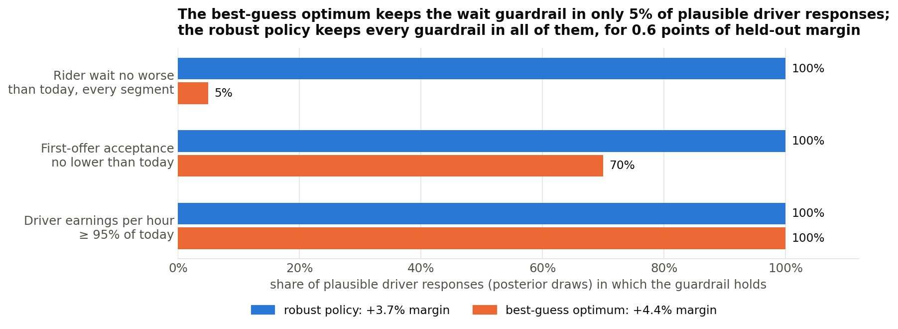
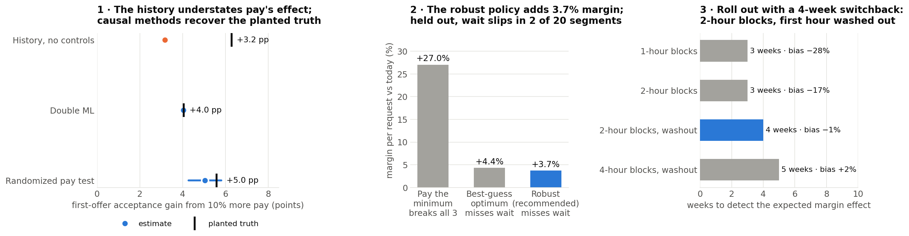
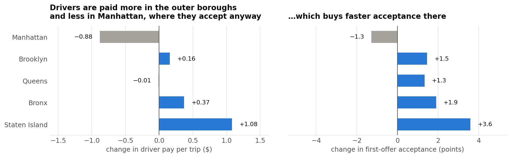

# Driver Pay in a Ride-Hailing Marketplace

[](https://github.com/janeruxi1/ridehail-driver-pay-optimization/actions/workflows/ci.yml)

[](https://janeruxi1-ridehail-driver-pay-optimization.streamlit.app/)

**[Decision memo](reports/decision_memo.md)** · **[Live demo](https://janeruxi1-ridehail-driver-pay-optimization.streamlit.app/)** · **[Full results](docs/results.md)** · **[Model card](reports/model_card.md)**

What should a ride-hailing platform offer a driver for each trip? Pay too little and drivers decline, so
riders wait and give up; pay too much and the margin disappears. Built end to end on **360,465,639 trips**
of real New York City records (January 2024 – June 2025): a PySpark pipeline, SQL marketplace health, a
demand forecast, a causal model of how drivers respond to pay, a constrained pay optimizer, a quote API in
Docker, and a switchback test to roll it out. Trips, fares, pay and waits are real; whether a driver accepted
an offer is simulated with a planted truth, so every causal method can be checked.

## Key results

- **Pay sits on the city's minimum for most trips:** the median trip is paid **1.003×** the minimum, so the
  lever is the premium above it (7.9% of driver pay).
- **The history understates what pay does by half.** It says 10% more pay buys +3.2 points of acceptance;
  the truth is +6.3, because premiums go to the trips drivers dislike. Double ML and a randomized pay test
  each recover their target.
- **A robust pay policy adds +3.7% margin per request** on held-out months and raises first-offer acceptance,
  with driver earnings kept. Paying only the minimum would "earn" +27% and break all three guardrails.
  The best-guess optimum earns +4.4% but keeps the wait guardrail in only 5% of plausible driver responses.
- **Robust to the model's uncertainty is not robust to its errors.** Scored against the truth, the robust
  policy's rider wait is at or below today in 18 of 20 segments but slips at the airports (about 1 second
  more wait from declined offers per trip in the evening), where the pay model overstates how drivers respond.
- **The pay test alone can check the policy, but not all of it:** off-policy evaluation recovers the gain in
  acceptance (+3.7 points, 95% interval +0.9 to +6.5; truth +3.3), yet can judge only 45% of the pay
  changes, because a third go beyond the ±15% the test randomizes.
- **It moves pay to where it buys service:** drivers get more per trip in the Bronx, Brooklyn and Staten Island
  and less in Manhattan, where they accept anyway; first-offer acceptance rises in every outer borough.
- **Roll it out with a switchback test** (regions × 2-hour blocks, first hour washed out), sized on real
  data at **4 weeks**.



*Why the robust policy: the share of posterior draws of driver behaviour in which each guardrail holds. The
best-guess optimum earns a little more but breaks the rider-wait guardrail in 95% of them. Drawn from the
recorded results by `scripts/make_readme_figure.py`.*

## How it works

| Step | Method | Where |
|---|---|---|
| Pipeline and health | PySpark on 360M rows with counted cleaning rules (99.88% pass); DuckDB SQL health metrics; zone clusters checked for stability | [01](notebooks/01_marketplace_health.ipynb) |
| Forecast demand | Direct multi-horizon LightGBM (Poisson), rolling-origin backtest: weighted MAPE **12.7%** vs 13.4% (4-week mean) | [02](notebooks/02_demand_forecast.ipynb) |
| Long-wait warning | Calibrated LightGBM, ROC AUC **0.739**; threshold from costs | [03](notebooks/03_long_wait_classifier.ipynb) |
| A real policy change | Difference-in-differences on the 2025 congestion fee: traffic **0.65 mph faster (4.6%)**, robust to placebo dates | [04](notebooks/04_congestion_fee.ipynb) |
| Pay-to-accept | Naive vs double machine learning vs randomized IV against a planted truth; hierarchical Bayesian logit (PyMC) | [05](notebooks/05_pay_to_accept.ipynb) |
| Optimize pay | Mixed-integer program (HiGHS) with five stakeholder guardrails, robust over posterior draws; dispatch simulation with batch matching | [06](notebooks/06_pay_policy_simulation.ipynb) |
| Serve and test | FastAPI quote service in Docker with CI/CD; switchback test sized by simulation with randomization inference | [API](src/ridepay/api.py) · [07](notebooks/07_switchback_design.ipynb) |



*Left: each method's estimate of pay's effect against the planted truth. Middle: margin against today on
held-out months for three policies. Right: switchback designs; shorter blocks are faster but biased by
carry-over.*



*Who gains and who pays, by pickup borough, held-out months. Where the extra pay goes is mapped by segment
and trip difficulty in the [full results](docs/results.md).*

## Data

[NYC Taxi & Limousine Commission](https://www.nyc.gov/site/tlc/about/tlc-trip-record-data.page)
High Volume For-Hire Vehicle records, public. The raw files (~8.5 GB) are never stored: the pipeline
processes one month at a time and keeps aggregates and a fixed 0.5% sample. Only aggregate results and the
zone map are committed. What is real and what is simulated is listed in [full results](docs/results.md).

## Limits

- **Acceptance is simulated**, so the causal methods are validated against a planted truth, not real drivers;
  a real platform would refit on logged offers and keep a live randomized pay slice wide enough to reach
  the premiums the policy uses.
- The policy is static: drivers learning to wait for premiums is not modelled; the switchback test is
  designed to catch it.
- The per-trip floor simplifies a standard enforced on weekly earnings, and the records combine several apps.
- The dispatch simulator's wait tail is heavier than the real one (p90 10.3 vs 8.7 min).

<details>
<summary><b>Run it</b></summary>

```bash
pip install -e ".[all]"                         # Python 3.10+, Java 17 for PySpark
python scripts/build_tables.py                  # ~4 min/month; downloads, cleans, aggregates, deletes raw
python scripts/build_notebooks.py --execute     # runs 01-07 on the real tables (~30 min)
pytest -q
docker build -t ridepay-quote . && docker run -p 8000:8000 ridepay-quote   # quote API, docs at /docs
streamlit run app/streamlit_app.py              # the demo
```

No download needed to try the code: `python scripts/make_synthetic.py` builds a small fake city, and
`RIDEPAY_SYNTHETIC=1` runs every notebook on it, which is what CI does.

</details>

<details>
<summary><b>Repository layout</b></summary>

```
src/ridepay/           etl (PySpark), data (DuckDB), pay floor, forecast, simulate, accept (DML, IV,
                       hierarchical), policy (MILP), dispatch simulator, quote, api (FastAPI)
notebooks/             0N_*.py (source of truth) and executed 0N_*.ipynb
reports/               metrics/*.json, figures/, decision memo, model card, brief; docs/results.md
models/quote_model.json  the served artifact, versioned with the code
app/                   Streamlit demo; tests/ estimators, optimizer guardrails, simulator, API, doc numbers
.github/workflows/     ci.yml (lint, tests, notebooks on a synthetic city, Docker smoke test), cd.yml (GHCR)
```

</details>

**Related:** [NYC congestion toll](https://github.com/janeruxi1/nyc-congestion-toll-causal-impact) picks up
notebook 04's open question ·
[Hotel search ranking](https://github.com/janeruxi1/Hotel-Search-Ranking) ·
[All projects](https://github.com/janeruxi1)
