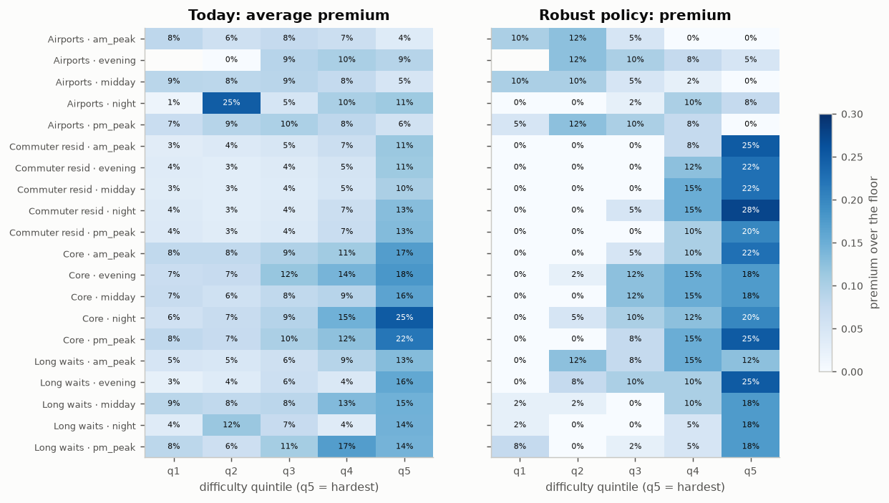
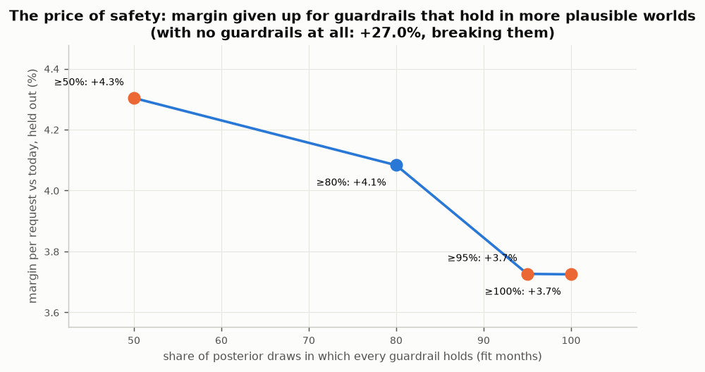

# Driver pay: full results

[← Back to the README](../README.md)

## Results

| Question | Answer | Notebook |
|---|---|---|
| How is pay set today? | The median trip is paid **1.003×** NYC's minimum pay for its miles and minutes; 53% of trips are paid within 1% of it. The **premium** above it (7.9% of all driver pay) is the lever. | [01](../notebooks/01_marketplace_health.ipynb) |
| Where is the marketplace under strain? | Waits track the supply–demand *balance*, not demand: the longest are around 4am on Sundays (correlation with hourly trips -0.15). Zones fall into 3 stable clusters plus airports. | [01](../notebooks/01_marketplace_health.ipynb) |
| How many trips next month, by zone and hour? | Weighted MAPE **12.7%** at zone × hour vs 13.4% (4-week mean) and 16.4% (seasonal naive); Poisson noise alone would give 6.8%. | [02](../notebooks/02_demand_forecast.ipynb) |
| Will this request wait > 10 minutes? | LightGBM, ROC AUC **0.739**, calibrated; a cost-based threshold fixed in advance cuts expected cost 16%. | [03](../notebooks/03_long_wait_classifier.ipynb) |
| What did the 2025 congestion fee do? | Traffic in the zone got **0.65 mph faster (4.6%)**, robust to placebo dates. Pickups fell, but by 9% or about 1% depending on the design. Effects on waits and driver pay per trip are **not** distinguishable from placebo noise. A fuller study in [`nyc-congestion-toll-causal-impact`](https://github.com/janeruxi1/nyc-congestion-toll-causal-impact) settles the size: the gap is a decline that started in 2023, and allowing for it, trips show no detectable change. | [04](../notebooks/04_congestion_fee.ipynb) |
| How much does 10% more pay raise acceptance? | The history says +3.2 pp; the truth is +6.3 pp (premiums go to the trips drivers dislike). **Double ML** and the **randomized pay test** each recover their estimand; with a hidden confounder only the test does. | [05](../notebooks/05_pay_to_accept.ipynb) |
| What should we pay? | A robust MILP policy: **+3.7% margin per request** on held-out months, scored against the truth, with acceptance and driver earnings guardrails met. Rider wait is at or below today in 18 of 20 segments and slips by about 1 second per trip in two airport segments, where the pay model overstates drivers' response: the policy is robust to the model's uncertainty, not to its errors. Cutting to the floor would "earn" +27% and break all three. | [06](../notebooks/06_pay_policy_simulation.ipynb) |
| How sure should the guardrails be? | A chance-constrained version keeps them in at least 50%, 80% or 95% of the posterior draws. Margin falls from +4.3% to +3.7% as caution rises; the 80% policy happens to clear the held-out check, but which one does depends on where the model is wrong, which is unknown before launch. | [06](../notebooks/06_pay_policy_simulation.ipynb) |
| Could the pay test alone have checked the policy? | Kernel-weighted off-policy evaluation on the randomized pay test puts the policy's gain in first-offer acceptance at **+3.7 points** (95% interval +0.9 to +6.5; truth +3.3, model +3.4), but it can judge only 45% of the trips whose pay the policy changes: 34% of the changes are beyond the test's ±15%. | [06](../notebooks/06_pay_policy_simulation.ipynb) |
| Does it hold up with real requests and moving drivers? | In a dispatch simulation replaying the real Brooklyn requests of two days, the policy raises first-offer acceptance by 1.4 points at a cost of $0.06 of margin per request there (the expected-value model predicts $0.14 for Brooklyn); its effect on waits is within simulation noise (p90 −0.38 min, 95% interval −0.76 to +0.00). Batched matching cuts mean wait by 9.0 min vs greedy. | [06](../notebooks/06_pay_policy_simulation.ipynb) |
| How do we roll it out? | Switchback test: region × 2-hour blocks, first hour washed out, randomization inference; sized on real data: **4 weeks** to detect the expected effect. | [07](../notebooks/07_switchback_design.ipynb) |

🎮 **[Try the live demo](https://janeruxi1-ridehail-driver-pay-optimization.streamlit.app/)**: quote a trip, explore where the policy puts premiums, and size the rollout test.

Every number here is read from [`reports/metrics/`](../reports/metrics), written by the notebooks when they
run on the real data, and CI checks the key ones in this README, the memo and the model card against those
records. The decision write-up is in [`reports/decision_memo.md`](../reports/decision_memo.md).



*Rows: zone group and time of day. Columns: trip difficulty, easiest (q1) to hardest (q5). Colour:
the premium above the minimum pay. Left is today; right is the recommended policy, which stops
paying extra for easy trips and puts the money on the hardest ones.*



*The price of safety. Each point is a policy fitted to keep every guardrail in at least the labelled share
of posterior draws, scored on held-out months against the truth; blue points keep every guardrail there.*

## The problem

A rider requests a trip; the platform offers it to a driver at an upfront pay; the driver accepts or
declines; a declined trip goes to the next driver. **The pay offered is the decision.**

- **Objective:** expected margin per request = P(trip completes) × (fare − pay) − P(rider gives up) × cost.
- **Constraints**, each owned by a different team:
  C1 pay between the regulatory floor and 1.3× it · C2 the same trip gets the same offer whoever receives it ·
  C3 rider wait per segment no worse than today · C4 first-offer acceptance no lower than today ·
  C5 driver earnings per hour per zone group at least 95% of today.
- **The trap:** operations add premiums to hard trips (short, late at night, into areas where drivers get
  stranded). Drivers decline those trips anyway, so in the history extra pay arrives with extra
  difficulty and pay looks far less effective than it is.

Full brief: [`reports/scenario_brief.md`](../reports/scenario_brief.md) · metric definitions:
[`reports/metrics_framework.md`](../reports/metrics_framework.md).

## Data: what is real and what is simulated

| Real: NYC TLC High Volume For-Hire Vehicle records | Simulated, calibrated to the real trips |
|---|---|
| 360,465,639 trips, Jan 2024 – Jun 2025: request, pickup, drop-off times and zones, miles, minutes, rider fare, driver pay, tips, fees | Whether the first driver offered a trip accepted it (planted model with known pay sensitivities) |
| Rider wait (request → pickup) | An 8% randomized pay test (±15%, never below the floor) |
| The congestion fee from 5 January 2025 | Drivers' positions and shifts in the dispatch simulation (supply calibrated hour by hour to real waits) |
| Every Brooklyn pickup on 10 and 14 June 2025, at full resolution, for the simulation | Riders giving up after declines or long waits |

The raw files (~8.5 GB) are never stored: `scripts/build_tables.py` processes one month at a time with
PySpark and keeps a zone × hour table, an origin–destination table, a fixed 0.5% trip sample and a
per-rule quality report (~25 MB a month). 99.88% of trips pass the cleaning rules; every
rule is counted, and two rules were changed after the first real month showed they removed real trips.

## How it was built

| Phase | What | Techniques |
|---|---|---|
| 0 | [Problem framing](../PROJECT_PLAN.md) | Objective, five stakeholder constraints, metric framework written before any data |
| 1 | [Pipeline and marketplace health](../notebooks/01_marketplace_health.ipynb) | PySpark on 360M rows; counted cleaning rules; SQL (DuckDB) health metrics built from sums; k-means zone clusters chosen by silhouette **and** bootstrap stability |
| 2 | [Demand forecast](../notebooks/02_demand_forecast.ipynb) | Direct multi-horizon LightGBM (Poisson) with origin-safe features; rolling-origin backtest; tuning on a separate window; Poisson noise floor |
| 3 | [Long-wait early warning](../notebooks/03_long_wait_classifier.ipynb) | Request-time features joined in SQL from the previous hour; time split; isotonic calibration; threshold from costs |
| 4 | [Congestion fee](../notebooks/04_congestion_fee.ipynb) | Year-over-year difference-in-differences, event study, placebo-date inference, dose–response |
| 5 | [Pay-to-accept](../notebooks/05_pay_to_accept.ipynb) | Naive vs double machine learning (cross-fitted) vs randomized IV, each against the true value of its own estimand; Bayesian hierarchical logit (PyMC) with diagnostics and posterior predictive checks |
| 6 | [Policy and simulation](../notebooks/06_pay_policy_simulation.ipynb) | Mixed-integer program (HiGHS) with guardrails, robust over posterior draws; out-of-sample scoring against the truth; discrete-event dispatch simulation with Hungarian-algorithm batch matching |
| 7 | [Quote service](../src/ridepay/api.py) | Installable package, FastAPI + Pydantic, Docker, GitHub Actions CI and CD to GHCR, [model card](../reports/model_card.md) |
| 8 | [Switchback test](../notebooks/07_switchback_design.ipynb) + [memo](../reports/decision_memo.md) | Switchback design sized by simulation on real block-to-block variation; randomization inference; decision rule fixed before the test |

## Quote service

```bash
docker build -t ridepay-quote .
docker run -p 8000:8000 ridepay-quote
curl -X POST localhost:8000/quote -H 'content-type: application/json' \
     -d '{"pickup_zone": 61, "dropoff_zone": 265, "request_time": "2025-06-14T02:15:00",
          "trip_miles": 0.8, "trip_minutes": 6, "rider_fare": 12.0, "prev_hour_wait_min": 9}'
```

```json
{"model_version": "ridepay-dd0381e2ca", "floor_pay": 5.52, "recommended_pay": 6.62, "premium_pct": 20.0, "segment": "Core|night", "difficulty_quintile": 5, "accept_probability": 0.2822, "completion_probability": 0.8676, "expected_margin": 4.01, "rule": "policy"}
```

A 0.8-mile trip at 2am from Crown Heights North that leaves the city, after an hour of long waits there, is in
difficulty quintile 5, so it gets a 20.0% premium; an ordinary 2.4-mile morning trip from
Midtown Center to Upper East Side North gets 0.0% (quintile 2). Inputs are validated (zones 1–263, positive
miles, …); the 1.3× cap is enforced in code whatever the artifact says; every response and log line
carries the model version. In-process latency: about 1 ms per quote. Interactive docs at `/docs`.

## Beyond ride-hailing

The same structure, paying a supply side to accept work under service-level guardrails, is how
food-delivery courier pay, freight brokerage (rate offered to carriers) and home-services
marketplaces (contractor payouts) are priced. The confounding (higher pay on harder jobs),
the need for randomized validation, segment-level curves with partial pooling, constrained optimization
and switchback-style tests carry over directly.

## Related project

[`nyc-congestion-toll-causal-impact`](https://github.com/janeruxi1/nyc-congestion-toll-causal-impact) picks up
the open question from notebook 04. It adds yellow taxis, two pre-toll years and data to August 2026,
and three methods that account for the zone's pre-toll decline (difference-in-differences with zone
trends, a forecast counterfactual and synthetic control). It confirms the faster traffic, finds no
detectable change in trips, and, measuring per hour rather than per trip, finds Uber/Lyft driver pay
per hour on a trip in the zone up about 3%; shared-ride requests fell about 13% (figures from that
project's own records). This project designs pay; that one measures a policy.
